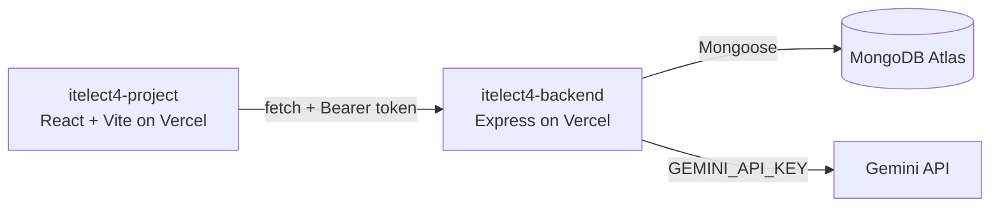

# itelect4-backend

[](https://github.com/nariokeith/itelect4-backend/actions/workflows/ci.yml)

The Express + MongoDB API for
[itelect4-project](https://github.com/nariokeith/itelect4-project). Both are deployed on
Vercel:

| | URL |
|---|---|
| Frontend (live) | https://itelect4-project-eta.vercel.app |
| Backend (live) | https://itelect4-backend-zeta.vercel.app |

Health check: https://itelect4-backend-zeta.vercel.app/api/health answers
`{"ok":true,"db":true}` once the API has reached MongoDB Atlas.

## Architecture



## Routes

| Method and path | Token? | Answers |
|---|---|---|
| `GET /api/health` | No | `{ ok, db }` |
| `GET /api/courses` | No | Every course, sorted by code |
| `GET /api/courses/:code` | No | One course, or 404 |
| `POST /api/auth/register` | No | 201 and the new user, or 409 |
| `POST /api/auth/login` | No | 200 and `{ token, user }`, or 401 |
| `GET /api/submissions` | Yes | Only this token's rows, newest first |
| `GET /api/submissions/:id` | Yes | One row, or 404 if it is not yours |
| `POST /api/submissions` | Yes | 201 and the row; owner taken from the token |
| `PATCH /api/submissions/:id` | Yes | 200 and the row after the change |
| `DELETE /api/submissions/:id` | Yes | 204 |
| `POST /api/ai` | Yes | 200 and a Gemini review; 400, 429 or 502 with a message (GT5) |

Private routes need the header `Authorization: Bearer <token>`, using the token from
`POST /api/auth/login`. Tokens expire after 2 hours.

Courses are read-only reference data, seeded by `npm run seed`. Submissions belong to the
account that created them.

## Environment variables

Copy `.env.example` to `.env` and fill it in. `.env` is never committed.

| Name | What it is |
|---|---|
| `MONGODB_URI` | MongoDB Atlas connection string |
| `JWT_SECRET` | Secret used to sign login tokens |
| `CORS_ORIGIN` | Comma-separated origins allowed to call the API, no trailing slash — `http://localhost:5173` locally, the frontend URL on Vercel |
| `GEMINI_API_KEY` | Google AI Studio key for Gemini — server-side only, never committed |
| `PORT` | Local dev only (default 4000); not set on Vercel |

## How to install and run

```bash
npm install
npm run seed     # puts the three courses in the database; safe to run twice
npm run try-ai   # one real Gemini request from the terminal; needs GEMINI_API_KEY
npm run dev      # API on http://localhost:4000
npm run build    # type-check and compile with tsc
npm test         # the Supertest file; needs JWT_SECRET, not the database or Gemini
```

## Tests and CI (GT6)

`tests/ai.test.ts` sends real requests to the real app from `src/app.ts` with Supertest —
no port is opened. It covers the one JWT-protected route that calls Gemini, `POST /api/ai`:

| Test | Expects |
|---|---|
| no `Authorization` header | 401 `No token. Send Authorization: Bearer <token>` |
| a token signed with another secret | 401 `Token is invalid or has expired` |
| a valid token, prompt `"Too short"` | 400 with the schema's 20-character message |

`vi.mock` replaces `src/config/db` with a `connectDB` that does nothing, so no database is
needed, and the valid-token test stops at the request schema, so Gemini is never called.
Only that test signs a token, so only it needs `JWT_SECRET`.

`.github/workflows/ci.yml` runs `npm ci`, `npm run typecheck` and `npm test` on every push.
`.env` is never pushed, so `JWT_SECRET` comes from the repository secret of the same name
(Settings → Secrets and variables → Actions).

## AI review (GT5)

`POST /api/ai` takes `{ "prompt": "<project description>" }` and answers with a review
from Gemini: `summary`, `strengths` (1–3), `improvements` (1–3) and `readiness`
(`ready` / `almost` / `not-yet`).

- **One Zod schema** (`src/schemas/review.ts`) is the `Review` type, the JSON Schema sent
  to Gemini as `responseJsonSchema`, and the `safeParse` check on the reply.
- **The prompt** (`src/ai/prompt.ts`) is a system prompt for ITELECT4 Tracker plus two
  worked examples (`ready` and `not-yet`). The student's text is wrapped in
  `<submission>` tags that the system prompt says to treat as data, never instructions.
- **The route** (`src/routes/ai.ts`) runs `requireAuth`, then a limit of five requests a
  minute per account (keyed on `req.userId`), then checks the body before calling Gemini.
  Gemini's quota error becomes 429; any other Gemini failure, or a reply that fails the
  schema, becomes 502. Gemini's own error text is logged, never sent to the browser.
- The model is `gemini-flash-lite-latest`, an alias Google moves to its current Flash-Lite
  model. It answers in about 2 seconds; `gemini-flash-latest` took 36–75 seconds in testing.

## Deployment

Vercel uses the Express preset, with `src/app.ts` and its `export default app` as the entry
point, so there is no `vercel.json`. `MONGODB_URI`, `JWT_SECRET`, `CORS_ORIGIN` and
`GEMINI_API_KEY` are set in the Vercel project settings. Atlas Network Access allows `0.0.0.0/0`, because Vercel's
IP addresses change. Every push to `main` redeploys.
